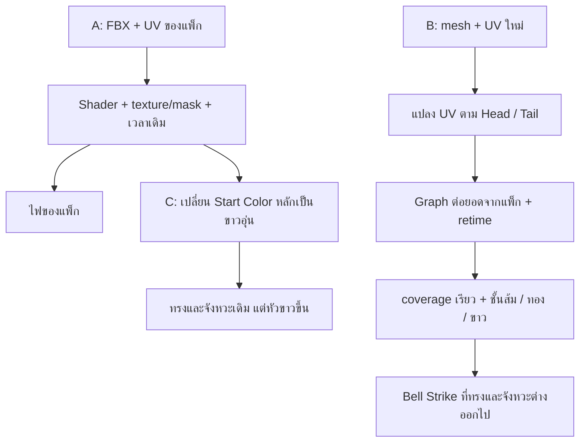

# Bell Strike: แพ็กเดิมกับเวอร์ชันของเรา

สรุปจากโค้ดและภาพ render วันที่ 2026-09-25 เฉพาะ editor preview ยังไม่ได้แทนสกิลในเกมจริง

**หลักการระดับใหญ่เหมือนกัน: mesh เป็นพื้นผิวรับ texture แล้ว shader คุมสี ความโปร่งใส และการสลายตามเวลา แต่เวอร์ชันที่เราดัดแปลงไม่ได้เปลี่ยนแค่ทรง mesh จึงได้ภาพต่างจากแพ็กมาก**

## 1. แพ็กเดิมกับเวอร์ชันดัดแปลง

ซ้าย A: prefab ของแพ็ก / ขวา B: Bell Strike บน mesh ครึ่งวงกลมที่เราสร้าง


ภาพจากเวลาเดียวกันในคลิป แต่ไม่ใช่ช่วง peak เดียวกัน: แพ็กแสดงโค้งเต็มแล้ว ขณะที่ของเรายังอยู่ระหว่างการไหลลง เพราะมีการเปลี่ยน timing ด้วย ภาพนี้เปรียบเทียบเอฟเฟคทั้งชุด ไม่ใช่การทดสอบ shader อย่างเดียว

สิ่งที่เห็น: A มีริ้ว ความโปร่ง และช่องว่างตามหาง ส่วน B อ่านเป็นแถบส้มกับขาวทึบ ขอบแบ่งสีชัด แต่รายละเอียดภายในอ่านยากกว่า

| ส่วน | A: แพ็กเดิม | B: เวอร์ชันดัดแปลง |
| --- | --- | --- |
| Mesh | FBX `Circle.005` พร้อมสันและ UV ที่ผู้ทำแพ็กจัดไว้ | mesh ครึ่งวงกลม 180 องศาและ UV ที่เราสร้างใหม่ |
| UV | ใช้ UV ของแพ็กกับ graph เดิม | เพิ่มตัวแปลง UV ตามช่วงหัวถึงหาง ก่อนส่งเข้า graph ที่ต่อยอดจากแพ็ก |
| การเคลื่อนของลาย | texture/mask/custom data และเวลาของแพ็ก | เพิ่ม `_Head`, `_Tail`, `_Fade` และยืดหรือบีบลายตามความยาวช่วงที่มองเห็น |
| เวลา | วงจร particle เดิม | หัวถึงปลายใน 0.2 วินาที หางตามช้ากว่า และ retime เวลาที่ส่งให้ shader/particle |
| สีขาว | ไม่มีชั้นขาวที่เราเพิ่ม | เพิ่ม carrier/material สีขาวแยกจากตัวส้มและขอบทอง |
| ความทึบ | ค่า material เดิม เช่น opacity 5.32 | ตัวส้ม opacity 16 และชั้นขาว 12 |
| เอฟเฟคประกอบ | ควัน สะเก็ด impact และ distortion ของแพ็ก | ปิดหลายชั้นเดิม แล้วใช้ aura, Hovl explosion และ hit star ของเรา |

**จุดต่างของ UV:** ของเราใช้ `(U - Head) / (Tail - Head)` ทำให้ช่วงหัวถึงหางที่ยาวขึ้นหรือสั้นลงรับลาย texture ช่วงเดิมทั้งชุด ลายจึงถูกยืดและบีบไปด้วย ไม่ใช่แค่เปิดเผยส่วนต่าง ๆ ของลายบน mesh

โค้ดยืนยันว่ามีการเปลี่ยนหลายอย่างพร้อมกัน ส่วนข้อสรุปว่าแถบขาวทึบและการยืด UV ทำให้ริ้วอ่านยาก เป็นการวิเคราะห์ร่วมกับภาพ ยังไม่ได้แยกปิดทีละปัจจัยเพื่อวัดผลของแต่ละตัว หางของ B ยังไม่ผ่านการยอมรับจากผู้ใช้

## 2. แพ็กเดิมกับเวอร์ชันเติมขาวล่าสุด

ซ้าย A: แพ็กเดิม / ขวา C: แพ็กเดิมที่เปลี่ยนสีหลักเป็นขาวอุ่น


**C ไม่ได้ใช้แถบขาวซ้อนแบบ B** เปลี่ยนเฉพาะ `Start Color` ของ particle หลักบน instance ชั่วคราว:

```text
A: (1, 0.35174727, 0, 1)
C: (1, 0.97,       0.91, 1)
```

Mesh, UV, shader, texture, opacity และ timing เหมือน A เอฟเฟคชั้นอื่นยังมีสีเดิม จึงรักษารูปทรงและจังหวะของแพ็กได้ ส่วนหัวขาวมากเพราะยังใช้ HDR gain เดิม ทำให้รายละเอียดบางส่วนในบริเวณสว่างสุดหายไปได้ ไม่ได้หมายความว่าเพิ่มขาวแล้วรายละเอียดจะดีขึ้นทุกส่วน

## 3. Pipeline แบบย่อ

แผนภาพนี้แสดงจุดที่ต่างกัน ไม่ใช่ลำดับทุก node ภายใน shader



## ข้อสรุปสำหรับงานต่อ

ใช้ C เป็นฐานทดลองต่อได้ เพราะคงชุด mesh/UV/mask/timing ของแพ็กไว้ แล้วค่อยเปลี่ยนทีละตัว เวลาจะเปลี่ยนทรง mesh ต้องรักษาทิศทาง สัดส่วน และการจัด UV ให้เข้ากับ shader ด้วย ไม่ใช่คัดลอก texture แล้วจะได้ทรงไฟเหมือนเดิมโดยอัตโนมัติ

กฎของงานใหม่ยังเหมือนเดิม: วาง carrier mesh ครั้งเดียวตอน spawn แล้วให้เอฟเฟคไหลผ่าน UV/mask ห้ามขยับ หมุน หรือดัด mesh ระหว่างเล่นเพื่อเลียนแบบการฟัน งาน orbit เก่าที่หมุน mesh ไม่ใช่ต้นแบบที่ผ่านกฎนี้แล้ว

### ขอบเขตการเทียบ

- ใช้ภาพ render ที่มีอยู่ ไม่ได้แก้เอฟเฟคหรือ render ใหม่ในงานสรุปนี้
- A/B ใช้ฉาก กล้อง exposure และจุดเริ่มเล่นเดียวกัน แต่ geometry, timing และแสง/particle ประกอบต่างกัน
- A/C ต่างกันเฉพาะสีหลักภายใต้ชุด preview เดียวกัน การทดสอบก่อนหน้าปิด tint แล้วได้เฟรมตรงกับ A ทุกพิกเซล
- A มีการจัดตำแหน่ง มุม ขนาด seed และการดับไฟท้ายเอฟเฟคเพื่อ capture ไม่ใช่ภาพ prefab ที่ไม่ผ่านการตั้งค่าใด ๆ และสะเก็ดใหญ่บางเส้นเกินขอบภาพ
- C ยังเป็นภาพทดลอง ความขาวล่าสุดยังไม่ถือว่าผู้ใช้อนุมัติขั้นสุดท้าย

### โค้ดและภาพเคลื่อนไหว

- [UV adapter และ coverage](/Users/lunalieneray/idle_mmorpg/unity/ROI/Assets/Editor/Vfx/Suzu/Shaders/FireOrbitCoverage.hlsl:5)
- [Head/tail และการเปลี่ยนเวลา](/Users/lunalieneray/idle_mmorpg/unity/ROI/Assets/Editor/Vfx/Suzu/SuzuBellStrikeStudy.cs:100)
- [ชั้นสีของเวอร์ชันดัดแปลง](/Users/lunalieneray/idle_mmorpg/unity/ROI/Assets/Editor/Vfx/Suzu/MaykerFireOrbitStudy.cs:77)
- [การเปลี่ยน Start Color ของแพ็กล่าสุด](/Users/lunalieneray/idle_mmorpg/unity/ROI/Assets/Editor/Vfx/Suzu/MaykerFireSlashPreview.cs:155)
- [A/B แบบช้า](/Users/lunalieneray/idle_mmorpg/docs/vfx/suzu-bell-strike/bell-vendor-vs-custom-slow.mp4)
- [A/C แบบช้า](/Users/lunalieneray/idle_mmorpg/docs/vfx/suzu-bell-strike/bell-vendor-white-comparison-slow.mp4)
